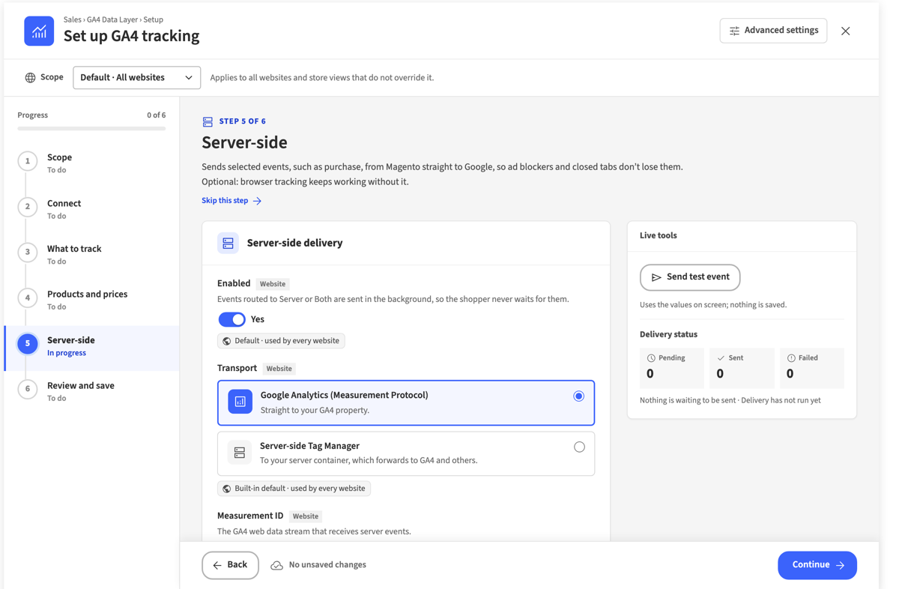

# Hryvinskyi_DataLayerServerSideAdminUi

Admin part of server-side delivery: the Server-side settings group, delivery status, Retry failed, Send test event and the setup wizard's server-side step.

The server-side step looks like the rest of the setup wizard: its fields, buttons and messages are parts of the shared admin UI kit (`hryvinskyi/magento2-admin-ui`), and its side panel (the test event and the delivery status) reads the kit's `--hui-*` colour, typeface and radius properties. A theme that restyles the kit restyles the step too.

Part of the GA4 Data Layer for Magento 2. The full user guide, covering setup, every setting and how to check what the store sends, is in [`docs/ga4-data-layer-guide.md`](https://github.com/hryvinskyi/magento2-data-layer/blob/main/docs/ga4-data-layer-guide.md) of `hryvinskyi/magento2-data-layer`.



## Installation

Install all GA4 Data Layer modules with the metapackage:

```bash
composer require hryvinskyi/magento2-data-layer-pack
bin/magento setup:upgrade
bin/magento setup:di:compile
bin/magento cache:flush
```

or this module alone:

```bash
composer require hryvinskyi/magento2-data-layer-server-side-admin-ui
```

## Requirements

- PHP ~8.3.0 or ~8.4.0
- `hryvinskyi/magento2-data-layer-api`
- `hryvinskyi/magento2-data-layer`
- `hryvinskyi/magento2-data-layer-server-side`
- `hryvinskyi/magento2-data-layer-admin-ui` 1.1 or later
- `hryvinskyi/magento2-admin-ui`
- `hryvinskyi/magento2-theme-assets`
- Magento 2.4.x
